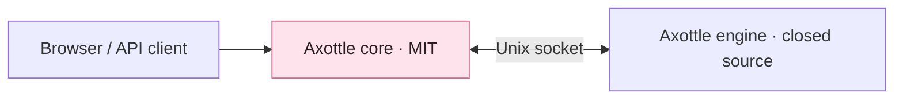

<p align="center">
  
</p>

<h1 align="center">Axottle Core</h1>

<p align="center"><strong>The open foundation for your infrastructure panel.</strong></p>
<p align="center">Accounts, projects, settings and audit — with a separately supplied engine for operational modules.</p>

<p align="center">
  
  
  <a href="LICENSE"></a>
</p>

<p align="center"><strong>English</strong> · <a href="README.ru.md">Русский</a></p>
<p align="center"><a href="#what-is-included">Inside the core</a> · <a href="#build">Build</a> · <a href="#run-the-standalone-core">Run</a> · <a href="#connect-the-engine">Engine</a></p>

---

Axottle is an infrastructure control panel for nodes, network flows and Remnawave operations. This repository contains its **MIT-licensed core**: a standalone browser interface and API, common account and project services, and the local transport to the proprietary engine.

> **Development snapshot:** the core/engine split is still being completed. This repository contains the foundation, not the full set of operational modules. A published split distribution is not yet available.

## What is included

| Component | Purpose |
| :--- | :--- |
| **Accounts & access** | Initial setup, sign-in, sessions and MFA. |
| **Projects** | Project identity and access boundaries. |
| **Settings** | Common preferences and account configuration. |
| **Audit** | A journal of actions handled by the core. |
| **Public interface** | Standalone pages built with Next.js and embedded in the Go binary. |
| **Engine transport** | HTTP entry point, local Unix socket connection and engine process supervision. |

Flow Studio, Flow Guard, nodes and agents, providers, integrations, support, Statuspage, subscriptions, security, network services, Telepurte and MCP belong to the **closed engine**. Their implementations are not included here.

## Build

You need Git, Python 3, Go matching [`go.mod`](go.mod), and Node.js matching [`web/admin/.nvmrc`](web/admin/.nvmrc), with npm.

Before building the Go binary, compile the public UI. Generated bundles are not tracked in this source repository.

```sh
git clone https://github.com/Axottle/axottle.git
cd axottle

# With nvm installed:
nvm install "$(cat web/admin/.nvmrc)"
nvm use "$(cat web/admin/.nvmrc)"

python3 scripts/open-core/build-ui.py
go build -trimpath -buildvcs=false -o axottle ./cmd/axottle-core
```

The UI builder installs dependencies from the lockfile, exports the public pages and stages them for embedding. Private module pages and their dependencies are excluded.

To run the core's Go tests:

```sh
go test ./...
```

## Run the standalone core

Provide a PostgreSQL database and configure the environment before starting:

| Variable | Purpose |
| :--- | :--- |
| `AXOTTLE_DB_URL` | PostgreSQL connection URL. The core initializes its common schema. |
| `AXOTTLE_SECRET_KEY` | Persistent secret used to protect stored credentials. Generate it once and keep it across restarts. |
| `AXOTTLE_HOST` | HTTP bind address; set `127.0.0.1` for local development. The default is `0.0.0.0`. |
| `AXOTTLE_PORT` | HTTP port; defaults to `8080`. |
| `AXOTTLE_PUBLIC_URL` | External URL used by the application. |
| `AXOTTLE_DATA_DIR` | Directory for runtime data. |

The built-in database credentials and secret are development defaults. Set your own values before deploying.

```sh
./axottle serve
```

Open `http://127.0.0.1:8080/setup` for initial setup. The `/health` endpoint includes database readiness when the core runs standalone.

## Connect the engine



The core automatically supervises an engine placed next to its executable as `axottle-engine`, or at `../install_static/axottle-engine` relative to that executable. Set `AXOTTLE_ENGINE_PATH` to select another engine binary.

To connect an independently managed engine instead, set `AXOTTLE_ENGINE_SOCKET`. Engine deployment and module configuration are separate from the standalone core setup above.

## Source layout

| Path | Contents |
| :--- | :--- |
| [`cmd/axottle-core/`](cmd/axottle-core/) | Core executable. |
| [`internal/core/`](internal/core/) · [`internal/coreapi/`](internal/coreapi/) | HTTP transport and standalone API. |
| [`internal/enginebridge/`](internal/enginebridge/) · [`internal/enginerun/`](internal/enginerun/) | Local engine connection and supervision. |
| [`web/admin/`](web/admin/) | Public UI source and locked dependencies. |
| [`scripts/open-core/build-ui.py`](scripts/open-core/build-ui.py) | Standalone UI builder. |
| [`export-manifest.json`](export-manifest.json) | Exported file hashes and snapshot metadata. |

This source tree is selected through an explicit allowlist and has its own Git history. The manifest describes the exported snapshot; it is not a signature or a substitute for signed release verification.

## License

The first-party core source is **licensed under MIT** — see [LICENSE](LICENSE). Third-party components and fonts retain their own licenses and notices.

The separately supplied proprietary engine is not covered by the core's MIT license.
