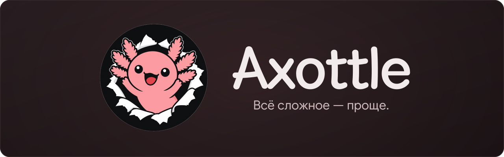

<p align="center">
  
</p>

<p align="center"><strong>Making the complex simple.</strong></p>
<p align="center"><strong>English</strong> · <a href="README.ru.md">Русский</a> · <a href="https://docs.axottle.com">Documentation</a> · <a href="https://docs.axottle.com/ru/getting-started/quickstart">Getting started</a> · <a href="https://t.me/axotalk">Community chat</a></p>

---

Axottle is a self-hosted control panel for running infrastructure built around Remnawave. Connect servers, design traffic routes, monitor services and manage customer support from one workspace.

It brings the operational picture together: which nodes serve a route, where a connection fails, which recovery policy applies and which customers are affected. From the first server to a distributed fleet, the same panel handles configuration, day-to-day operations and incident response.

## Flow Studio in action

Add nodes, connect routes and build your topology on one canvas.

https://github.com/user-attachments/assets/17ec1460-6b67-475f-a343-31c3b20ea4d2

## What you can do

### Nodes and providers

Connect existing servers over SSH or create VPS instances through supported provider APIs. Choose an account, region, plan and operating system; install services, agents and TLS. Manage node groups and server deletion where the provider adapter supports it, with explicit controls for destructive operations.

### Flow Studio

Build visual topologies with entry points, transit nodes, WARP, CDN and routing rules on one canvas. Connect external HTTP proxies, import existing Remnawave configurations, manage Flow versions and inspect diagnostics before applying changes.

### Transports and load balancing

Manage HAProxy servers, routes, pools, connection limits and port rotation. Run OpenFlux and Telegram proxy fleets alongside the rest of your network, with configuration and operational state available from the panel.

### Flow Guard and RescueFlow

Build recovery scenarios with checks, conditions and explicit action branches. Reprovision a server, replace a node, transfer its role in Flow and switch routes where supported. Choose manual execution or permitted automation, then follow each attempt in the execution history. Available provider actions depend on the adapter.

### Multiple Remnawave panels

Connect several Remnawave panels to one Axottle installation. Organize work by project, synchronize users, import configurations into Flow, manage updates and move installations between servers.

### Monitoring and service status

Inspect node metrics, service health, TLS and route checks, and external probes. Track incidents, receive Telegram notifications and publish component status and scheduled maintenance through Statuspage.

### DNS, CDN and GeoAssets

Manage Cloudflare AutoDNS, CDN provider accounts and resources, and SelfSteal masking. Maintain GeoIP, geosite and custom lists used by routing rules, with their updates managed from the panel.

### Subscriptions and Happ

Publish customer subscription pages connected to Remnawave. Configure Happ themes, personalize presentation, send announcements to users or groups and use the subscription API for integrations.

### Support and team workflows

Turn Telegram messages into tickets with priorities, SLA, ownership and conversation history. Work from the panel, a Telegram forum or a dedicated operator portal. Maintain a knowledge base, review support analytics and coordinate responses to shared incidents.

### Security and access controls

Investigate abuse signals, configure QoS and node protection profiles, and manage outgoing traffic with Egress Guard. Control team permissions and MFA, protect stored secrets with encryption and review operations in the audit log.

### Backups and recovery

Schedule backups for Axottle and Remnawave, configure retention and store archives locally or in S3-compatible storage, including R2 and MinIO. Encrypt archives, verify their integrity and restore data through the available recovery tools.

### Telepurte — server access

Use Web SSH and an SSH bastion, grant temporary access through a link and review session recordings. Run permitted commands across selected server groups and schedule operational tasks. Telepurte can run independently and connect to Axottle for sign-in and node synchronization.

### API and MCP

Connect external clients and automate operations through scoped permissions. The searchable MCP catalog loads only the operation schemas needed for the task.

## From your first node to daily operations

1. **Connect your installation.** Set up Axottle, connect Remnawave and register your nodes.
2. **Build a Flow.** Choose the nodes, entry points and routing your service needs.
3. **Check and apply.** Review the configuration, apply it and inspect the result.
4. **Operate from one panel.** Watch health, configure recovery, handle support requests and publish service status.

## Install

On a Linux server (amd64 or arm64) with `curl`. Run as root or use an account with `sudo` access:

```bash
curl -fsSL https://raw.githubusercontent.com/Axottle/axottle/main/install.sh | bash
```

The installer requests `sudo` itself when needed and keeps setup, progress and the result in one terminal window.

Installs **v2.0.0**. The interactive installer downloads the matching core and engine, verifies their signatures and sets up the panel. [Release notes](https://github.com/Axottle/axottle/releases/tag/v2.0.0).

## Community

Join the [Axottle community chat](https://t.me/axotalk) to ask questions, share your setup and discuss ideas.

## Documentation

**[Read the Axottle documentation →](https://docs.axottle.com)**

Installation, configuration, operator guides and troubleshooting are available in the documentation. The guides are currently in Russian.

[Requirements](https://docs.axottle.com/ru/getting-started/requirements) · [Quick start](https://docs.axottle.com/ru/getting-started/quickstart) · [First connection](https://docs.axottle.com/ru/getting-started/first-connection) · [Flow Studio](https://docs.axottle.com/ru/connection-units/overview) · [Flow Guard](https://docs.axottle.com/ru/connection-units/recovery)

<details>
<summary><strong>Building from source</strong></summary>

This repository contains the source available for the shared foundation of Axottle. Operational modules are supplied separately; building this checkout alone does not provide all of the product features described above. The installer downloads the complete distribution.

Use Go from `go.mod`, Node.js from `web/admin/.nvmrc`, npm and Python 3.

Before building the Go binary, compile the public UI. Generated bundles are not tracked in this source repository.

```sh
python3 scripts/open-core/build-ui.py
go build -trimpath -buildvcs=false -ldflags='-X github.com/axottle/axottle/internal/version.Version=v2.0.0' -o axottle ./cmd/axottle-core
go test ./...
```

For standalone development, configure `AXOTTLE_DB_URL` and a persistent `AXOTTLE_SECRET_KEY`, then run `AXOTTLE_HOST=127.0.0.1 ./axottle serve`. Set `AXOTTLE_ENGINE_PATH` to use a separately supplied engine binary, or `AXOTTLE_ENGINE_SOCKET` to connect to a running engine.

The source in this repository is licensed under MIT; see [LICENSE](LICENSE). Separately supplied modules and third-party components retain their own terms.

</details>
