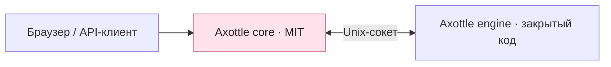

<p align="center">
  
</p>

<h1 align="center">Axottle Core</h1>

<p align="center"><strong>Открытая основа вашей панели управления инфраструктурой.</strong></p>
<p align="center">Учётные записи, проекты, настройки и аудит — с отдельным движком для прикладных модулей.</p>

<p align="center">
  
  
  <a href="LICENSE"></a>
</p>

<p align="center"><a href="README.md">English</a> · <strong>Русский</strong></p>
<p align="center"><a href="#состав-ядра">Состав ядра</a> · <a href="#сборка">Сборка</a> · <a href="#запуск-самостоятельного-ядра">Запуск</a> · <a href="#подключение-движка">Движок</a></p>

---

Axottle — панель управления инфраструктурой: нодами, сетевыми схемами и операциями Remnawave. В этом репозитории находится **ядро под MIT**: самостоятельный интерфейс и API, общие сервисы учётных записей и проектов, а также локальный транспорт для подключения закрытого движка.

> **Снимок для разработки:** разделение ядра и движка ещё завершается. Этот репозиторий содержит основу панели, а не полный набор прикладных модулей. Опубликованной разделённой поставки пока нет.

## Состав ядра

| Компонент | Назначение |
| :--- | :--- |
| **Учётные записи и доступ** | Первичная настройка, вход, сессии и MFA. |
| **Проекты** | Идентификация проектов и границы доступа. |
| **Настройки** | Общие параметры и конфигурация учётных записей. |
| **Аудит** | Журнал действий, обрабатываемых ядром. |
| **Публичный интерфейс** | Самостоятельные страницы на Next.js, встроенные в Go-бинарник. |
| **Транспорт движка** | Входящий HTTP, соединение через локальный Unix-сокет и управление процессом движка. |

Flow Studio, Flow Guard, ноды и агенты, провайдеры, интеграции, поддержка, Statuspage, подписки, безопасность, сетевые сервисы, Telepurte и MCP относятся к **закрытому движку**. Их реализация не входит в этот репозиторий.

## Сборка

Нужны Git, Python 3, Go версии из [`go.mod`](go.mod) и Node.js версии из [`web/admin/.nvmrc`](web/admin/.nvmrc) вместе с npm.

Перед сборкой Go-бинарника соберите публичный UI. Сгенерированные файлы интерфейса не хранятся в этом репозитории исходников.

```sh
git clone https://github.com/Axottle/axottle.git
cd axottle

# Если установлен nvm:
nvm install "$(cat web/admin/.nvmrc)"
nvm use "$(cat web/admin/.nvmrc)"

python3 scripts/open-core/build-ui.py
go build -trimpath -buildvcs=false -o axottle ./cmd/axottle-core
```

Сборщик UI устанавливает зависимости по lockfile, экспортирует публичные страницы и подготавливает их к встраиванию. Страницы закрытых модулей и их зависимости исключены.

Go-тесты ядра запускаются отдельно:

```sh
go test ./...
```

## Запуск самостоятельного ядра

Подготовьте базу PostgreSQL и настройте переменные окружения перед запуском:

| Переменная | Назначение |
| :--- | :--- |
| `AXOTTLE_DB_URL` | URL подключения к PostgreSQL. Ядро инициализирует свою общую схему. |
| `AXOTTLE_SECRET_KEY` | Постоянный секрет для защиты сохранённых учётных данных. Создайте его один раз и сохраняйте между перезапусками. |
| `AXOTTLE_HOST` | Адрес HTTP-сервера; для локальной разработки укажите `127.0.0.1`. По умолчанию — `0.0.0.0`. |
| `AXOTTLE_PORT` | HTTP-порт; по умолчанию — `8080`. |
| `AXOTTLE_PUBLIC_URL` | Внешний URL приложения. |
| `AXOTTLE_DATA_DIR` | Каталог рабочих данных. |

Встроенные учётные данные базы и секрет предназначены для разработки. Перед развёртыванием задайте собственные значения.

```sh
./axottle serve
```

Для первичной настройки откройте `http://127.0.0.1:8080/setup`. В самостоятельном режиме проверка `/health` учитывает готовность базы данных.

## Подключение движка



Ядро автоматически запускает и контролирует движок, расположенный рядом с его исполняемым файлом под именем `axottle-engine` либо по пути `../install_static/axottle-engine` относительно этого файла. Другой бинарник движка можно указать через `AXOTTLE_ENGINE_PATH`.

Для подключения к отдельно запущенному движку задайте `AXOTTLE_ENGINE_SOCKET`. Развёртывание движка и настройка модулей выполняются отдельно от описанного выше запуска самостоятельного ядра.

## Структура исходников

| Путь | Содержимое |
| :--- | :--- |
| [`cmd/axottle-core/`](cmd/axottle-core/) | Исполняемый файл ядра. |
| [`internal/core/`](internal/core/) · [`internal/coreapi/`](internal/coreapi/) | HTTP-транспорт и самостоятельный API. |
| [`internal/enginebridge/`](internal/enginebridge/) · [`internal/enginerun/`](internal/enginerun/) | Локальное соединение с движком и управление его процессом. |
| [`web/admin/`](web/admin/) | Исходники публичного UI и зафиксированные зависимости. |
| [`scripts/open-core/build-ui.py`](scripts/open-core/build-ui.py) | Самостоятельный сборщик UI. |
| [`export-manifest.json`](export-manifest.json) | Хеши экспортированных файлов и метаданные снимка. |

Дерево исходников формируется по явному списку разрешённых файлов и имеет собственную историю Git. Манифест описывает экспортированный снимок; он не является подписью и не заменяет проверку подписанного релиза.

## Лицензия

Собственный код ядра распространяется **под MIT** — см. [LICENSE](LICENSE). Сторонние компоненты и шрифты сохраняют свои лицензии и уведомления.

Отдельно поставляемый закрытый движок не покрывается MIT-лицензией ядра.
